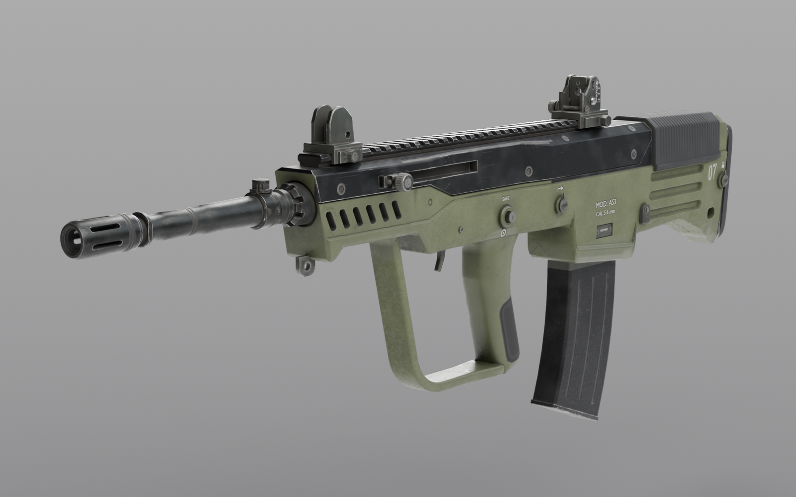

# weaponforge

Builds a first-person game weapon from a small definition written in Python, headless in Blender 5.2: the game mesh and a
high-detail bake source, UVs, the bakes, three PBR textures (BaseColor, Normal, ORM), a rig with sockets, LODs and a world
copy with box collision, the FBX files, a JSON spec of all of it, every automatic check, review pictures and presentation
pictures. An optional adapter imports the result into Unreal.

*AssaultG3, one of the two weapons in this repository, as `weaponforge assault_g3 hero` pictures it: the exported game mesh
with its game textures (here with its painted texture sets; see [the examples](docs/examples-and-layout.md)).*

It is for people who make first-person weapons for a game and would rather describe one than model it by hand: a weapon is
three Python files (its dimensions, one builder per part, and how the parts make a weapon), and every stage after that is a
command. Everything the tool makes is measured: what is too big, too thin, out of budget, colliding when it moves, missing a
socket or wrong in the exported files is a `MISS` line with a number, not a matter of opinion.

## How it is meant to be used

weaponforge is meant to be driven by an AI coding agent that designs and judges while the tool builds. The agent writes the
definition, runs the stages, reads the checks and looks at the pictures; a person decides what the weapon should be and
approves it at four points. The loop (the full order is under "The order of work for a new weapon"):

1. **Ask the person** what the weapon is for and how it should feel, before anything is modelled (`CRAFT.md` lists the
   questions and what earlier weapons taught, step by step).
2. **Start and design it**: `weaponforge new`, then `weapons/<id>/BRIEF.md`, then the concept for the person's approval, then
   the definition (`params.py`, `parts.py`, `weapon.py`).
3. **Build**: `bin/weaponforge <id> model render --what grey`, and on through `uv bake texture rig check export`.
4. **Compare passes**: `bin/weaponforge <id> review --against <the previous build>` makes side-by-side crops and measured
   figures of two builds, so each pass is judged against the last one rather than from memory ([docs/review.md](docs/review.md)).
5. **Record what was learned** (`CRAFT.md`, section 6): a technique goes into the shared code, a standard or a mistake into
   `CRAFT.md` at the step where the next weapon will meet it, the full story into `PLAYBOOK.md`. The design itself stays in
   the weapon's folder: every weapon is its own design, and what carries over from one to the next is craft, not parts.

`skills/weaponforge-new-weapon/SKILL.md` is that loop as a skill an agent can load. `CRAFT.md` is the short read before a
weapon; `PLAYBOOK.md` is the long one for when something goes wrong (about 1,400 lines: read it in parts, by section). A person can
of course drive the tool by hand: every step is a command, and every file is plain Python.

## What you need

- **Blender 5.2**, run headless (`blender -b`). The Cycles bake uses a GPU when Blender finds one (HIP, OptiX, CUDA, oneAPI,
  Metal) and the CPU otherwise. A live Blender window is never needed.
- **bash and python3** for the launcher and the tests (any python3; nothing to install into it).
- **texforge** (optional), the companion tool that turns a painted picture into a tiling texture set or a decal. Without it
  the named finishes use their procedural patterns ([the examples](docs/examples-and-layout.md)).
- **Unreal Engine** (optional), only for the Unreal adapter ([Unreal](docs/unreal.md)).

Tested on Linux (native Blender, CPU) and on Windows 11 with WSL2 (Windows Blender, GPU, started from WSL). macOS should
work the same way as Linux but has not been tried ([limits](docs/limits-and-tests.md)).

## Install

    git clone <this repository> weaponforge && cd weaponforge
    export WEAPONFORGE_BLENDER=/path/to/blender          # or put blender on PATH, or see "Configure"
    bin/weaponforge list                                 # the weapons defined

There is nothing to build or install: `bin/weaponforge` starts Blender with the repository's own Python. **Where to run
it:** the launcher finds the repository from its own path, so it works from any folder, and every example in these documents
is written as typed from the repository's root (`bin/weaponforge ...`, `tests/smoke.sh`). From another folder, give the
launcher's path (`/path/to/weaponforge/bin/weaponforge ...`) or put `bin/` on your PATH. A relative path in an option
(`--root`, `--blend`, `--against`, `--out`) or in a `WEAPONFORGE_*` variable is read from the folder you are in, not from the
repository.

## Configure

Nothing has to be configured. Every setting has a default, and three places can change it; the first that has a value wins:

1. an environment variable, `WEAPONFORGE_<KEY>`: the key in capitals with the table's name in front (`WEAPONFORGE_ASSETS`,
   `WEAPONFORGE_UNREAL_CONTENT`);
2. the settings file: `weaponforge.toml` at the top of the repository (git-ignored), or the file `WEAPONFORGE_CONFIG`
   names. `weaponforge.example.toml` lists every key with a comment: copy it and uncomment what you need;
3. the default.

| Key | Environment | Default | What it is |
|-|-|-|-|
| `blender` | `WEAPONFORGE_BLENDER` | `blender` on PATH | the Blender 5.2 executable |
| `assets` | `WEAPONFORGE_ASSETS` | `build/weapons` | the asset root: each weapon's `.blend`, bakes, textures, FBX files and spec go to `<assets>/<id>/`; presentation pictures, viewer copies and review packs to `<assets>/_gallery/` |
| `spec_dir` | `WEAPONFORGE_SPEC_DIR` | none: beside the weapon's files | where `<id>.json` goes (e.g. your game project's documents) |
| `materials` | `WEAPONFORGE_MATERIALS` | none | one more folder searched for painted texture sets and decals |
| `unreal.content` | `WEAPONFORGE_UNREAL_CONTENT` | `/Game/Weapons` | the Unreal folder each weapon is imported to, as `<content>/<Name>/` |
| `unreal.master_material` | `WEAPONFORGE_UNREAL_MASTER_MATERIAL` | `/Game/Materials/M_Weapon` | the parent of every `MI_<Name>` ([Unreal](docs/unreal.md)) |
| `unreal.param_base_color`, `unreal.param_normal`, `unreal.param_masks` | `WEAPONFORGE_UNREAL_PARAM_...` | `BaseColor`, `Normal`, `ARM` | the master material's three texture parameters |
| `unreal.param_roughness_scale`, `unreal.param_metallic_scale` | `WEAPONFORGE_UNREAL_PARAM_...` | `RoughnessScale`, `MetallicScale` | its two scalar parameters |
| `unreal.editor` | `WEAPONFORGE_UNREAL_EDITOR` | none | `UnrealEditor-Cmd` (or `UnrealEditor-Cmd.exe` from WSL), for the adapter only |
| `unreal.project` | `WEAPONFORGE_UNREAL_PROJECT` | none | the `.uproject` the adapter imports into |

`bin/weaponforge settings` prints every value and where it came from. A relative path in the file is taken from the file's
folder; a default path is in the repository. `weaponforge/settings.py` is the one place that reads them (in Blender, in the
launcher and in the Unreal runner alike).

**Under WSL with a Windows Blender** (a `blender.exe`, for its GPU): set `WEAPONFORGE_BLENDER` to the `.exe`. The launcher
hands it every path in Windows form (`/mnt/d/x` becomes `D:\x`) and passes the `WEAPONFORGE_*` variables through `WSLENV`;
a path in the settings may be written either way. Keep the repository and the asset root on a Windows drive (`/mnt/c`,
`/mnt/d`, ...): a WSL-only folder such as `/tmp` reaches the Windows Blender only as a `\\wsl.localhost\...` share, which is
slow and has not been tested.

## Quick start

The template is a small made-up pistol that runs every stage in about two minutes with a GPU (three and a half on a CPU):

    bin/weaponforge _template all --size 512 --strict          # model uv bake texture rig check export render verify
    bin/weaponforge _template hero                             # two presentation pictures of what was exported

The last lines say `26 of 26 checks pass` and `[verify] RESULT: all files match the spec`. With the default settings the
files are in `build/weapons/_template/` (the working `.blend`, `bake/`, `textures/`, `export/` with the FBX files, `renders/`
with the review sheets, and the spec `_template.json`), and the pictures in `build/weapons/_gallery/hero/TemplateGun.png` and
`TemplateGun_rear.png`. `bin/weaponforge _template view` adds `build/weapons/_gallery/3d/TemplateGun.glb`, the exported weapon with
its textures inside, for any browser 3D viewer.

The `texture` stage also prints, once, `painted sets not found: tiling sets phosphate, poly_mould; ...`: the template asks
for two painted texture sets that are not in this repository, so it keeps their procedural pattern instead. That is
expected, not a failure; [the examples](docs/examples-and-layout.md) says how to make the sets and where they are looked for.

To start a weapon of your own, follow "The order of work for a new weapon" below: `bin/weaponforge new <id> <Name> <TAG>` is
its third step, after reading `CRAFT.md` and asking the person.

## Commands

    bin/weaponforge list                                 the weapons defined
    bin/weaponforge new <id> <Name> <TAG>                start one from the template
    bin/weaponforge settings                             the settings and where each came from
    bin/weaponforge <id> <stage> [<stage> ...] [opts]    run stages headless: model uv bake texture rig check export render verify, or all
    bin/weaponforge <id> view                            a .glb of the exported weapon with its textures inside
    bin/weaponforge <id> hero [--shots ...] [--pose NAME]  presentation pictures of the exported weapon, at rest or in a pose
    bin/weaponforge <id> review [--against DIR]          a review pack; with --against, pairs with another build
    bin/weaponforge <id> unreal-import                   the optional Unreal adapter: import the exported weapon
    bin/weaponforge <id> unreal-check                    ... and read it back and compare it with the spec

[docs/stages.md](docs/stages.md) says what each stage does, writes and takes. `--root DIR` on any stage writes everything, the spec
included, under `DIR/<id>/` instead of the asset root: the way to try something without touching a weapon's real files.

## What a weapon definition is

A folder `weapons/<id>/` with three Python modules and a brief:

    params.py   every dimension, in centimetres, pure Python (no Blender)
    parts.py    one builder per part: fn(coll, hp=False) leaves mesh objects in the weapon frame, each tagged with its bone
                and its surface kind; hp=True makes the bake source (more segments, the small cuts the normal map carries)
    weapon.py   WEAPON = an instance of a Weapon subclass: names, budget, bones, sockets, props, what moves, poses, the look,
                collision, extra checks
    BRIEF.md    what the weapon is, in words and centimetres, agreed before modelling

The frame: origin in the grip, +X toward the muzzle, +Z up, +Y the weapon's left; one Blender unit is one centimetre. The
stages know nothing about any one weapon: everything comes from the definition, through the hooks of
`weaponforge/weapon.py` ([docs/definition.md](docs/definition.md) and the pages it points to).

## The order of work for a new weapon

The same order in this file, in `CRAFT.md`, in the skill and in the text `weaponforge new` prints. The person who asked for the
weapon approves four things (the concept, the high-detail model, the textures, the look in the game); do not go past an approval
without it. The details of every step are in [docs/building.md](docs/building.md).

1. **Read `CRAFT.md`, whole.** It is short: what earlier weapons got wrong and what fixed it, put before the step where it
   matters, and the questions to ask.
2. **Ask the person** `CRAFT.md`'s questions (section 1), on every weapon, before anything is modelled.
3. **Start the weapon:** `bin/weaponforge new <id> <Name> <TAG>` (for example `new shotgun_g1 ShotgunG1 SG1`). It copies the
   template to `weapons/<id>/`. **The template is a small pistol**: a long gun replaces `parts.py` and most of `weapon.py`
   (read `weapons/assault_g3` for how its rig, poses and sockets are set up, not for its parts).
4. **Write `weapons/<id>/BRIEF.md`**: outline, assemblies, hardware, marks, wear story, size, what moves, what the game finds
   on it, budget.
5. **Show the concept**: the brief, two or three to-scale side outlines that differ in kind, a recommendation, and what each
   differs in, in `<asset root>/<id>/ref/` ([docs/concept.md](docs/concept.md)). **Approval 1: the concept.**
6. **Build.** Write the definition. Blockout and detail on the game parts, then the high-detail model: **approval 2**. Then
   `uv bake texture rig` at 1024 px until the look is right and once at full size: **approval 3, the textures**. Then `check`,
   `export` and `verify`; then, optionally, Unreal; then the game: **approval 4, the look in the game**. Compare each pass with
   the one before (`review --against`).
7. **Record what the weapon taught** (`CRAFT.md`, section 6).

**What costs time, before the first round of changes** ([docs/stages.md](docs/stages.md) has the table): measured at 4096 px on
a mid-range GPU, `uv` with the tight pack takes about 4 minutes, `bake` 6.5 to 7, `texture` about 3, a full `render` 3.2 and
`review --against` 3.5; `model` is 14 to 18 seconds and `check` 15. So: **the triangle count is only measured after `uv`**;
**any change to the game mesh means `uv` again**, so collect model changes and make them together; **`render --what grey` straight after `model` (6 s) also shows the
grey model from the player's hip and aiming eyes**, so look there before any stage that costs minutes; `check` straight after
`model` measures the model only and names the stages it left out as stale; and **`review --against` needs a kept copy of the earlier build's
folder**, so copy `<asset root>/<id>/` before a round of changes.

## The reference

Everything that used to be one long file is split by subject; each file is short enough to read whole. The right-hand column
names the old section titles that code comments and older notes still cite.

| File | What is in it | Old section titles |
|---|---|---|
| [docs/building.md](docs/building.md) | the order of work step by step, with the commands | "A new weapon" |
| [docs/concept.md](docs/concept.md) | what "show the concept" is, and where the pictures go | |
| [docs/stages.md](docs/stages.md) | costs, every stage and its options, `view`, `hero`, `review` as commands, a live Blender, the spec | "The stages", "In a live Blender", "The spec" |
| [docs/definition.md](docs/definition.md) | the definition's hooks: review sheets, what can be left out, budget, brief, collision, spec keys | "The definition, in more detail" |
| [docs/kit.md](docs/kit.md) | the modelling kit, organic parts, the shared builders and what they are and are not | "Organic parts", "Shared builders" |
| [docs/rig.md](docs/rig.md) | bones, sockets, props, moves, poses, the names the tool and the examples use, sign conventions | "Bones", "Sockets", "Props", "Moves", "Poses" |
| [docs/look.md](docs/look.md) | surface kinds, the steel finish and the named finishes, wear, lettering, painted sets and decals, edge masks | "Named finishes", "Edge masks by the centimetre", "Painted texture sets and decals" |
| [docs/texels.md](docs/texels.md) | texel density by place and by view, UV seams | "Texels by place", "Texels by view" |
| [docs/review.md](docs/review.md) | the review pack, the figures, holding them as checks, the critic | "Review" |
| [docs/variants.md](docs/variants.md) | a weapon that extends another | "A variant of a weapon" |
| [docs/unreal.md](docs/unreal.md) | the optional adapter, its rules, the master material | "Unreal" |
| [docs/examples-and-layout.md](docs/examples-and-layout.md) | the shipped examples, the painted sets, the folders | "The examples", "Where things are" |
| [docs/limits-and-tests.md](docs/limits-and-tests.md) | what the tool does not prove, the tests, what is not known to work | "What the tool does not prove", "Changing the tool", "Not known to work" |

Beside them: `CRAFT.md` (read before a weapon), `PLAYBOOK.md` (every wall met, by stage), `weaponforge.example.toml` (every
setting) and `skills/weaponforge-new-weapon/SKILL.md` (the loop as an agent skill).

## Known limits

The Unreal adapter has not been run in an engine since it was taken out of the project it was written in; nothing the tool
makes has been seen rendered by Unreal; macOS and native Windows are untried. [docs/limits-and-tests.md](docs/limits-and-tests.md)
has the list.

## License

MIT; see `LICENSE`.
