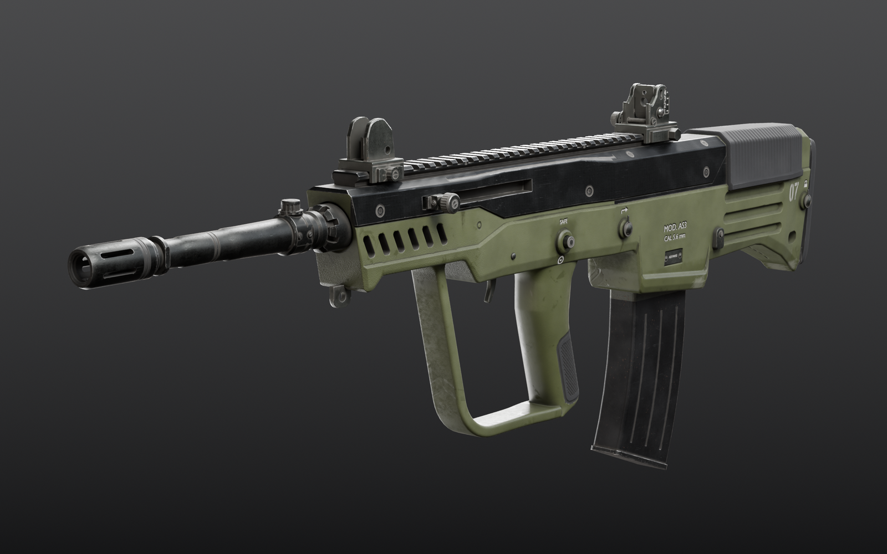
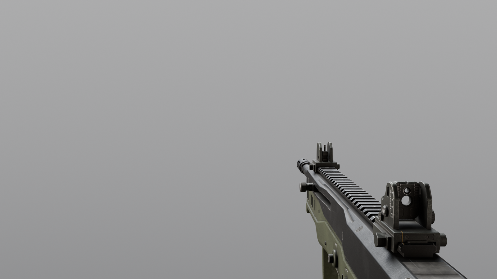

# The examples, and where things are

## The examples

Two weapons ship. Both are the tool's own designs: no real maker's name, model or markings is on either, and none may be
added.

- **`_template` (TemplateGun)**: a small blocky pistol, every block of its `weapon.py` commented. It is the thing
  `weaponforge new` copies and the weapon the tests build. Two of its named finishes would lay painted sets on if they were found;
  without them they are procedural, and the template passes every check either way.
- **`assault_g3` (AssaultG3)**: a bullpup rifle, a full-size example (26,648 triangles at LOD0, 4096 px textures): one polymer
  shell cut by every hole, a rail with clamped sights, rubber pads, a texel layout by what the player sees, named finishes,
  lettering filled with paint, decals. Building it at full size takes a while on a GPU and much longer on a CPU; `--size
  1024` is the size to iterate at.

**AssaultG3's painted texture sets are not in this repository.** Its look lays twelve texforge pictures on top of the
procedural recipes: four tiling sets (moulded polymer, rubber, anodised alloy, phosphate) and decals (a stencilled rack
number, a paint-pen witness mark, oil leaks and scrapes); `sets.json` lists twelve, three of which (`turned`, `label_14`,
`leak`) are recorded but not placed on AssaultG3 today. Without them it still builds: the named finishes keep their procedural
patterns, the decals are left out, and the `texture` stage says once which sets it did not find and where it looked. The
pictures above were made with them. `weapons/assault_g3/painted/` is the record of how to make them again: `sets.json`
(each set's prompt, the candidate chosen and why, the exact texforge arguments, where it goes on the weapon) and
`regenerate.sh <texforge launcher> <output folder>`, which writes them in the layout the tool looks for
(`<output>/_materials/<name>/`). Point the setting `materials` (or `WEAPONFORGE_MATERIALS`) at that `_materials` folder.
Two things will differ from the pictures above:

- The five tiling sets and the leak and scrape decals start from pictures an image generator makes (`texforge gen`), and a
  generator never gives the same picture twice: the regenerated sets look alike, not the same.
- The three hand-made decals (`make_decals.py`, seeded) come out byte for byte the same only with the two fonts they were
  drawn with (Arial Bold and Ink Free, from a Windows Fonts folder: `FONTS=<folder>`). Without them it draws with a free
  font it finds (Liberation Sans, DejaVu Sans), and the lettering of the stencil and the label differs a little.
  The stencil is drawn white on black and `regenerate.sh` gives `texforge decal` no `--background`: with `--image`, texforge
  finds the background from the picture's border ([look.md](look.md), "Painted texture sets and decals (texforge)").

Sets are looked for by name, in this order: the weapon's own `textures/`; `_materials/` beside the weapons under the asset
root the weapon is built in (so a `--root` trial can carry its own copy); `_materials/` under the configured asset root
(sets several weapons share); the `materials` folder (`surface.material_dirs`). A set is the folder `<name>/` holding
`<name>_BaseColor.png`, `<name>_Height.png`, for a decal `<name>_Opacity.png`, and `<name>.texforge.json`.

## Where things are

    bin/weaponforge              the launcher (bash): starts Blender headless, or hands over to the Unreal runner
    bin/new_weapon.py            `weaponforge new`
    weaponforge/                 the shared code: everything about a weapon comes from its definition
      settings.py                the settings (weaponforge.toml, WEAPONFORGE_*); pure Python
      weapon.py                  what a definition is (the Weapon class, Prop, Move, Zone, Decal, TexelZone) and where its files live
      stages.py                  the pipeline, one function per stage           <- read its header first
      kit.py                     modelling helpers the builders use (prisms, lathes, lofts, booleans, bevels, text)
      fittings.py                small things several weapons carry: screws, pins, plates, sling fittings, moulding and selector marks
      sections.py, forms.py      a faceted section (plain Python) and the loft, pocket and boss built on it; marks placed on a surface
      stocks.py                  what wooden long-gun stocks share: the recoil pad, the grip cap, checkering (no shipped weapon uses it)
      variant.py                 a variant that changes its base's dimensions: the base's files run again with numbers pinned
      mesh.py, uv.py             cleanup to an engine-safe triangle mesh; unwrap and pack
      bake.py, maps.py           high detail -> normal / occlusion / ID / curvature and wear masks
      surface.py, finish.py      the look: material recipes, painted sets and decals, the texture bake; named finishes
      rig.py                     pivots, armature, socket joints, LODs, FBX export, the spec
      collision.py, check.py     box collision for the world copy; every automatic check
      view.py                    review renders
      verify_fbx.py              reads the exported FBX files back and compares them with the spec
      viewer.py, hero.py         `view` (a .glb for a browser) and `hero` (presentation pictures)
      review.py, critic.py       `review` (packs, crops, figures, pairs) and the optional judge run on them
      cli.py                     the command line, run inside Blender
    weapons/_template/           the small pistol to copy
    weapons/assault_g3/          the bullpup; painted/ is the record of its painted sets; sights.py and barrels.py are its own
                                 designs (rail-clamped iron sights; a gas block, castellated nut and flash hider)
    integrations/unreal/         the optional Unreal adapter: run.sh, weapon_import.py, weapon_check.py, weapon_spec.py
    tests/                       smoke.sh, kit_builders.sh, review.sh, finishes.sh and the plain-Python tests ([limits-and-tests.md](limits-and-tests.md))
    skills/weaponforge-new-weapon/   the agent skill
    docs/                        the reference (the README's "The reference" lists it); docs/images/ the pictures in this file
    CRAFT.md, PLAYBOOK.md        the craft before a weapon; the walls already climbed
    weaponforge.example.toml     every setting, commented

A weapon's files, under the asset root (`build/weapons/` by default):

    <id>/
      <id>.blend                 the working file: collections <TAG>_LP (game parts), <TAG>_HP (bake source), <TAG>_GAME (what is exported),
                                 <TAG>_MARKS (copies of the engraved lettering, for the bake's lettering mask; hidden from renders)
      <id>.json                  the spec (unless spec_dir is set): what the game side reads about the weapon ([stages.md](stages.md), "The spec")
      bake/                      normal.npy, masks.npy, id.npy, cover.npy, preview_*.png (preview_missed.png: where no ray found detail),
                                 marks.npy and preview_marks.png when the weapon has lettering (where the letters are, one channel per ink),
                                 bake.json (the share of missed texels, read by the check "bake: rays find the detail"; the share whose
                                 normal points into the game mesh, read by "bake: detail faces outward")
      textures/                  T_<Name>_BC.png, _N.png, _ORM.png; work/uv_layout.png; any source pictures
      export/                    SKM_<Name>.fbx, SKM_<Name>_LOD1.fbx, ..., SM_<Name>.fbx, SM_<Name>_<Prop>.fbx
      renders/                   the review sheets (stage "render")
    _materials/                  painted sets several weapons share (optional)
    _gallery/hero/               <Name>.png, <Name>_rear.png, ... (`hero`)
    _gallery/3d/                 <Name>.glb (`view`)
    _gallery/review/<Name>/      review packs (`review`)
